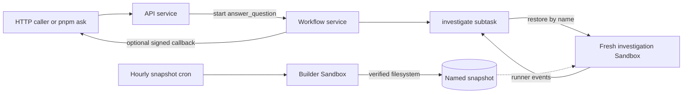

# Architecture

This document maps the repository, traces the two core execution paths, and
describes the interfaces between the API, workflow, Sandbox, and agent
runner. For deployment use [0_QUICKSTART.md](0_QUICKSTART.md); for supported
customization use [1_EXTENSION.md](1_EXTENSION.md).

## System overview

The Blueprint in [`render.yaml`](../render.yaml) creates three services:

- **API** (`codebase-researcher-api`) accepts HTTP questions, rebuilds the
  conversation for follow-ups, starts durable workflow runs, and serves their
  results. It holds no state of its own.
- **Workflow** (`codebase-researcher-workflow`) orchestrates each question,
  restores a fresh Sandbox, runs the agent inside it, validates the result,
  and optionally delivers a callback.
- **Snapshot cron** (`codebase-researcher-snapshots`) periodically prepares a
  verified, immutable repository snapshot for later investigations.



The host process remains the trusted orchestrator. The agent process and every
model-directed tool command execute inside the investigation Sandbox. This
keeps the model next to the read-only checkouts while the workflow retains
control of provisioning, credentials, deadlines, validation, retries, and
cleanup.

## Directory overview

```text
config.ts                     Instance name, repositories, Git credentials, snapshot name
prompt.md                     Instance-specific agent instructions
render.yaml                   Blueprint for the API, workflow, and cron
.env.example                  Environment variable reference
docs/
  0_QUICKSTART.md             Deploy, ask, follow up, develop, operate
  1_EXTENSION.md              Corpus, model, agent, API, and integration extension points
  2_ARCHITECTURE.md           Repository map, execution paths, interfaces
  3_TAKEAWAYS.md              Reusable agent and Sandbox patterns
src/
  api.ts                      Hono API: start, follow up, and poll questions
  ask.ts                      `pnpm ask` client: post, poll, print the reply
  workflow.ts                 Workflow task registration, retries, timeout budgets
  tasks.ts                    Parent, investigation, and delivery task bodies
  cron.ts                     Scheduled snapshot refresh entry point
  question.ts                 Public question, callback, metadata, and Reply contracts
  investigation.ts            Transcript, agent result, evidence, evidence URL contracts
  manifest.ts                 Configured repository profile and resolved Sandbox manifest
  bot-config.ts               config.ts validation and environment overrides
  callback.ts                 Callback HMAC signing and verification
  log.ts                      Structured JSON logger
  sandbox/
    interface.ts              Provider-neutral Sandbox and OpenSandbox contracts
    index.ts                  Render/local provider selection
    local.ts                  Unisolated local implementation for development and tests
    runner-bundle.ts          Self-contained runner.mjs build
    render/
      config.ts               Render workspace, timeout, egress, and credential config
      client.ts               Paced and retrying Sandbox API wrapper
      snapshot.ts             Resolve heads, build snapshot, prune old snapshots
      sandbox.ts              Restore, verify, run, collect output, terminate
  runner/
    main.ts                   In-Sandbox runner entry and credential handling
    protocol.ts               Typed host/runner input and event stream
    session.ts                Agent prompt, turn loop, model retries, deadlines
    tools.ts                  Read, list, and guarded shell tools
    submit.ts                 Structured result and citation validation
    model.ts, providers.ts    Model registry and provider-key mapping
    events.ts                 Redacted JSONL event emitter
    faux.ts                   Deterministic no-model execution
    core-prompt.md            Shared investigation instructions
sandbox/
  install-tools.sh            Prepare Node, Git, ripgrep, and timeout
  as-runner.sh                Drop privileges and clear the environment
  run-investigation.sh        Bound one run and persist events/exit status
  verify.sh                   Verify files, credentials, permissions, runner, egress
  build/                      Builder-only Git credential and scrub scripts
test/                         API, workflow, runner, Sandbox, and runtime tests
```

`.scratch/` contains local checkouts, local run directories, and the local
runner bundle. It is ignored by Git.

## Core execution paths

### 1. Refresh the repository snapshot

The hourly cron calls `refreshSnapshot` in [`src/cron.ts`](../src/cron.ts):

1. Resolve each configured branch head with `git ls-remote`.
2. Bundle the runner and its packages into one `runner.mjs`.
3. Create a builder Sandbox with allow-all egress and a provider-side timeout.
4. Upload runtime scripts and the runner, install required tools, create the
   unprivileged `investigator` user, and run the runner self-test.
5. Upload host-specific Git credentials, clone exact commits, and immediately
   scrub and verify those credentials.
6. Write the repository manifest, make repositories root-owned and read-only,
   make only scratch writable by `investigator`, and delete builder staging.
7. Run `verify.sh`. No snapshot is created unless verification succeeds.
8. Capture the filesystem under a stable snapshot name and terminate the
   builder in `finally`.
9. Keep the newest two snapshots with that name. A failed refresh leaves the
   previous snapshot available.

The schedule does more than fetch recent commits: rebuilding before snapshots
expire keeps the question path available. Stable naming lets the cron replace
the underlying snapshot without coordinating with active workflow runs.

### 2. Start a question

`POST /v1/questions` in [`src/api.ts`](../src/api.ts):

1. Authenticates `API_TOKEN` and validates the body: a `question`, plus an
   optional `follow_up_to`, callback, and metadata.
2. Builds the transcript. A new question is one `user` message. A follow-up
   verifies the earlier question ID, reads that workflow run, and takes its
   input transcript, then its reply as an `agent` message, then the new
   question.
3. Starts `answer_question` with `AnswerQuestionInput`, forwarding an
   optional idempotency key.
4. Returns a signed question ID. `GET /v1/questions/:id` verifies that
   signature before reading the workflow run.

The API has no database. Each workflow run stores the full conversation it
answered, so a chain of follow-ups only ever reads the latest run.

### 3. Orchestrate the workflow

[`src/workflow.ts`](../src/workflow.ts) registers:

- `answer_question`: parent task; validates input, invokes `investigate`,
  builds a public reply, invokes `deliver` when requested, and logs one
  `turn_finished` outcome.
- `investigate`: retryable infrastructure boundary; opens and runs a fresh
  Sandbox.
- `deliver`: independently retryable signed callback POST.

The parent does not retry. Infrastructure failures thrown by `investigate`
retry on a fresh Sandbox; model and submission failures become user-safe
failure replies rather than spending the model budget again.

Timeouts are layered. The runner has its own deadline, the in-Sandbox script
wraps it with `timeout`, the host stops waiting after a grace period, Render
terminates the Sandbox after `SANDBOX_TIMEOUT_SECONDS`, and the workflow task
has an outer computed deadline.

### 4. Open and verify an investigation Sandbox

`investigateTask` in [`src/tasks.ts`](../src/tasks.ts):

1. Resolves the configured model and derives its API hostname.
2. Selects the Render or local Sandbox provider.
3. Opens the newest available snapshot by name.
4. On Render, waits for the Sandbox to run, verifies the exact requested
   network policy and HTTPS egress rules, runs `verify.sh` with egress probes,
   and downloads the manifest.
5. Builds `RunnerInput` from the transcript, manifest, in-Sandbox paths,
   model, and timeout.
6. Calls `sandbox.run` and always calls `sandbox.close()` in `finally`.

Each question gets a new Sandbox. Reusing one would save restore time but
would allow files, processes, and environment changes from one question to
reach the next.

### 5. Run the agent inside the Sandbox

The workflow uploads `input.json` and a one-time model-key file, then executes
[`sandbox/run-investigation.sh`](../sandbox/run-investigation.sh).
That script:

1. Gives the run directory to the unprivileged runner user.
2. Starts the bundled runner through `as-runner.sh` with a minimal environment.
3. Bounds it with coreutils `timeout`.
4. Writes JSONL events and the exit status to root-owned files outside the
   runner-owned directory.
5. Deletes the key file again on exit.

[`src/runner/main.ts`](../src/runner/main.ts) reads and deletes the key,
removes all provider-key variables from its environment, redirects library
console output to stderr, validates `RunnerInput`, and starts the agent
session.

The agent's `read`, `ls`, and `bash` tools all execute in the same Sandbox
against its read-only repositories. The shell receives an allowlisted
environment with scratch as `HOME` and `TMPDIR`. The command policy rejects
obvious writes, network tools, installs, and privilege escalation, but the
actual boundaries are filesystem permissions and Sandbox egress.

### 6. Validate and return the result

The only accepted agent output is `submit_investigation`:

1. Parse `InvestigationResult`.
2. Require evidence for observed claims.
3. Validate repository name and commit against the manifest.
4. Resolve contained source symlinks to their canonical target paths. Reject
   traversal, metadata paths (including aliases into `.git`), unavailable or
   non-regular targets, and files absent from the manifest commit. Validate
   line ranges against the tracked target blob at that commit, so the
   returned path and evidence URL identify the content that was checked.
5. Return validation errors to the model for up to three submissions.

Git object reads are local, bounded to 5 seconds and 16 MiB per read, and do
not apply checkout filters or fetch missing objects. Refresh snapshots after
deploying citation-validation changes so new Sandboxes receive the new runner.

The runner emits one terminal `result` or `error` event. The host downloads
the event file even if the live exec stream dropped, classifies the run, and
checks evidence against the manifest again. Trusted host code pins full
commits and constructs evidence URLs.

Finally, `answer_question` produces `answer`, `clarification`, or `failure`.
The result remains pollable and, when requested, `deliver` sends the same
reply in a signed callback.

## Core interfaces

### Public question contract

[`src/question.ts`](../src/question.ts) is the boundary between the API and
the workflow:

- `AnswerQuestionInput`: transcript, optional callback, optional metadata.
- `StartQuestion`: how the API starts a run; tests replace it with a fake.
- `Reply`: answer, clarification, or failure.
- `replyText`: a reply rendered as the agent's turn in a follow-up.

HTTP concerns such as auth, question IDs, and `follow_up_to` stop at the API.
The workflow receives only a complete transcript.

### Investigation contract

[`src/investigation.ts`](../src/investigation.ts) defines:

- the transcript: oldest-first `{ role: "user" | "agent", text }` messages,
  with `MESSAGE_MAX_CHARS` and `TRANSCRIPT_MAX_MESSAGES` limits;
- `FinalAnswer` and `NeedsClarification`;
- `Evidence`, including repository, commit, path, and line range;
- `buildEvidenceUrl`, called only after validation.

The result deliberately distinguishes observed code, inferred behavior, and
what was not established.

### Repository manifest

[`src/manifest.ts`](../src/manifest.ts) separates configured intent from
resolved state:

- `RepoProfile`: repositories, branches, URLs, and browsing styles to build.
- `RepoManifest`: exact commits and paths present in one snapshot.

The manifest pins the evidence and is downloaded before the Sandbox receives
the model key.

### Sandbox seam

Application code depends on [`src/sandbox/interface.ts`](../src/sandbox/interface.ts):

```typescript
type Sandbox = {
  id: string;
  manifest: RepoManifest;
  reposRoot: string;
  scratchDir: string;
  info: Record<string, unknown>;
  run(options: RunInvestigationOptions): Promise<RunInvestigationResult>;
  close(): Promise<void>;
};

type OpenSandbox = (
  snapshotName: string,
  options: { timeoutMs: number },
) => Promise<Sandbox>;
```

The Render implementation restores a real Sandbox. The local implementation
runs the same bundle as a child process against clean local checkouts and
provides no isolation.

### Host/runner protocol

[`src/runner/protocol.ts`](../src/runner/protocol.ts) is shared by both sides:

- `RunnerInput`: trace, transcript, manifest, paths, model, thinking level,
  and deadline.
- `RunnerEvent`: `started`, tool calls/results, assistant text, usage, and
  exactly one terminal `result` or `error`.
- `RUNNER_EXIT`: stable success, error, invalid-input, and timeout codes.

The runner writes JSONL on stdout and free-form diagnostics on stderr. Event
redaction happens before serialization. Tolerant host parsing preserves valid
events from a process killed mid-line.

## Trust boundaries

The design assumes questions and repository content can steer the agent
adversarially.

- The **builder** has broad egress and temporary Git credentials but never
  runs the agent. Third-party setup and runner self-test happen before
  credentials arrive.
- The **investigation Sandbox** runs the agent but has no Git credentials,
  read-only repositories, one writable scratch directory, and HTTPS egress
  limited to the model provider by default.
- The **runner** holds the model key in memory. Its execute-only Node binary
  makes the process non-dumpable, and `verify.sh` must prove that property
  before the key is uploaded.
- The **host workflow** treats Sandbox output as untrusted, repeats manifest
  checks, constructs links, classifies failures, and owns cleanup.

`verify.sh` checks the actual builder and every restored Sandbox instead of
assuming the build steps worked. Known residual risks remain: DNS resolves
arbitrary names, the model provider host is shared, and anyone allowed to ask
can retrieve content from every configured repository.

The rationale and patterns behind these choices are summarized in
[3_TAKEAWAYS.md](3_TAKEAWAYS.md).
